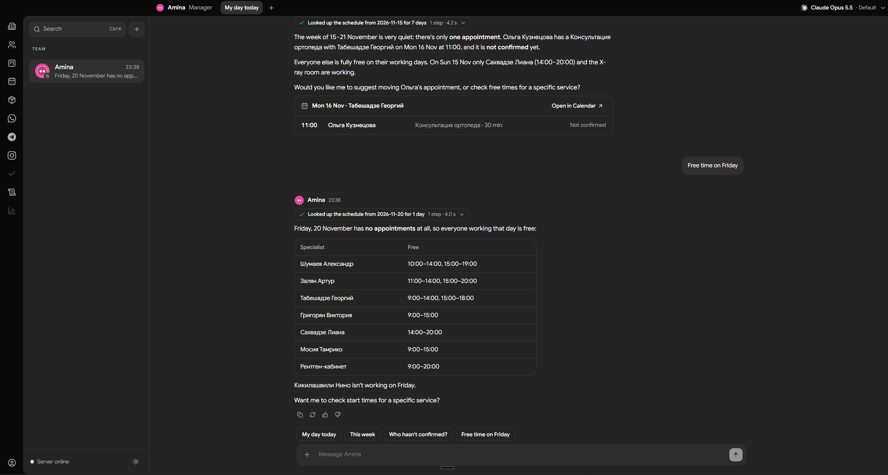

<p align="center">
  
</p>

# Scope Bot

> **Hire AI employees. Keep people in charge.**
>
> An open-source CRM where AI employees do the work and your team supervises. Businesses run it on their own server.

In most CRMs people do the work, and the CRM keeps the records. Scope Bot turns this around: AI employees answer clients, keep contacts and deals up to date, book appointments and follow up, while the team sets goals and limits, approves what is risky, and steps in when needed.

Scope Bot is not a commercial service. There is no hosted version to sign up for: a business, or someone helping it, runs it on its own server or computer, with its own LLM and channel accounts. It is a general CRM for small and mid-sized businesses in any industry; what only some need, such as a calendar, comes as an optional module.

## What it does today

- **AI employees.** Hire one with a role (sales, customer support, follow-ups, reports), give it a job title, instructions, permissions and limits, and group employees into departments. Each employee has its own model, with backups if one fails.
- **Clients on WhatsApp, Telegram and Instagram.** All chats land in one inbox. Until the business lets an employee answer alone, every reply is a draft a person sends, changes or throws away, and an employee hands a chat to a person when it should.
- **A chat with your team.** Ask an employee about the day, the week or a client. Answers are written live, show the steps taken and why, and can be asked again. The team teaches the employee rules from its answers. Questions can be spoken as well as typed.
- **CRM core.** Contacts, deals in pipelines with stages, services, notes, tasks and approvals. Figures on the screens are computed from the data, never by a model.
- **Calendar (optional).** Specialists, rooms and equipment with working hours. Employees find free times, book, move and cancel, and clients get reminders in the chat they wrote from.
- **Activity log.** Everything an employee did, why, and who approved it.
- **Team accounts.** Owners, admins and members, each seeing what their role allows.
- **Your choice of model.** Anthropic, or any OpenAI-style API (OpenAI, OpenRouter, DeepSeek and others). For trying things out, Claude Code or Codex signed in on the same computer.

## Status

Scope Bot is in active development. It runs on your own computer for trying it out, with a server and a desktop app. A Docker Compose setup for running it on a server is next on the [roadmap](docs/roadmap.md).

## Running it

Requires Node.js 24+, pnpm 11 and PostgreSQL 15 or newer.

```sh
cp .env.example .env   # set DATABASE_URL, SCOPE_BOT_SECRET and the LLM settings
pnpm install
pnpm build:web         # builds the interface the server shows in a browser
pnpm dev:server        # then open http://localhost:3000
```

`pnpm dev` starts the server with the desktop app instead. On the first start the server writes a setup code to its log: enter it in the browser or the app to create your business and become its owner. Your team then joins with invites. The comments in `.env.example` explain each setting. More commands and details are in [CONTRIBUTING.md](CONTRIBUTING.md).

## Documentation

- [Architecture](docs/architecture.md): principles, how the parts fit together, tech stack
- [Domain model](docs/domain.md): every entity in detail
- [Decisions](docs/adr/): why things are the way they are
- [Roadmap](docs/roadmap.md): what comes next, and open questions

## Contributing

Pull requests are welcome. Read [CONTRIBUTING.md](CONTRIBUTING.md) for the development setup, conventions and the rules for AI coding assistants. Found a security problem? Report it privately, as [SECURITY.md](SECURITY.md) explains.

## Licence

[AGPL-3.0](LICENSE). Any business may use Scope Bot for its work. Whoever changes it and lets other people use it over a network must offer them the changed source. Why this licence: [ADR 0027](docs/adr/0027-open-source-distribution-and-versions.md).
